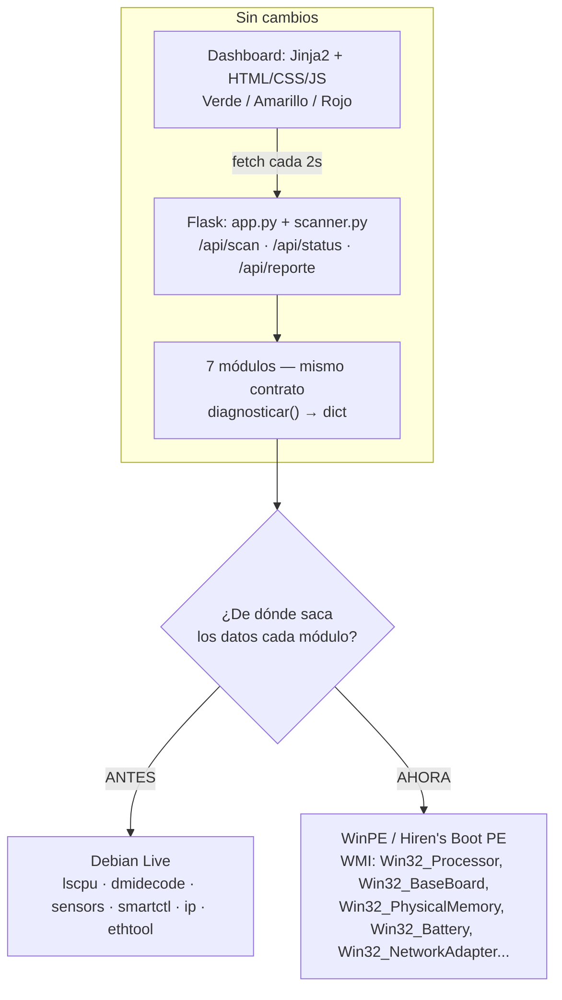
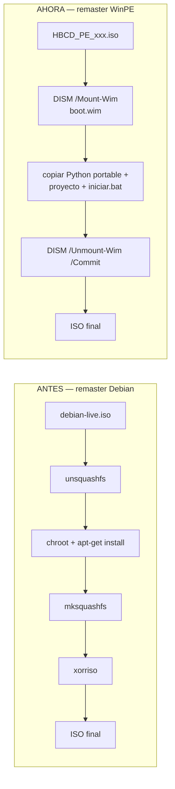

# Pivote a WinPE / Hiren's Boot PE — Implementation Plan

> **For agentic workers:** REQUIRED SUB-SKILL: Use superpowers:subagent-driven-development (recommended) or superpowers:executing-plans to implement this plan task-by-task. Steps use checkbox (`- [ ]`) syntax for tracking.

> **Estado (2026-08-13):** Fase 1 completa y validada en hardware real (una laptop Lenovo distinta a la de desarrollo) — booteó Hiren's PE vía Ventoy en modo WIMBOOT, corrió el flujo completo (`iniciar.bat` → Flask → dashboard con mapa/ficha/detalle → escaneo real → descarga de reporte). En el camino aparecieron dos bugs reales que ya están corregidos (`sys.path` restringido en el Python embeddable, capacidad de RAM física vs. disponible al SO) — ver decisiones 16 y 17 en `docs/DECISIONES.md`. Queda un hallazgo sin resolver: `red.py` no detectó la tarjeta de red física en ese hardware (decisión 15, riesgo abierto). Arrancar la Fase 2 desde acá.

**Goal:** Reemplazar la base de arranque de Diagnostic Scanner PC — de un remaster de Debian Live a un remaster de Hiren's Boot PE (WinPE) — porque las laptops objetivo son equipos Windows, y la detección de hardware (WiFi, sensores, batería) es mucho más confiable con drivers Windows nativos que con Linux genérico. El dashboard, el backend Flask y el contrato de los 7 módulos **no cambian**; solo cambia la capa que cada módulo usa para leer el hardware.

**Architecture:** Flask + Jinja2 + JS vanilla siguen corriendo igual, sobre un Python portable embebido en el USB (WinPE no trae Python). Cada módulo de `backend/modules/` pasa de invocar herramientas CLI de Linux (`dmidecode`, `lscpu`, `sensors`, `smartctl`, `ip`, `ethtool`) a consultar **WMI** vía el paquete `wmi` de Python. El ISO se remasteriza con **DISM** (montar/editar/desmontar `boot.wim`) en vez de `unsquashfs`/`chroot`/`mksquashfs`/`xorriso`.

**Tech Stack:** Python 3.10+ (embeddable portable), Flask, psutil (sin cambios — ya es multiplataforma), paquete `wmi` (Windows Management Instrumentation) nuevo, Hiren's BootCD PE como ISO base, Ventoy para el boot (sin cambios), DISM para el remaster offline.

## Global Constraints

- El contrato de módulo NO cambia: `diagnosticar() -> dict` con llaves `componente`, `estado` (`ok`/`advertencia`/`critico`/`error`), `mensaje`, `datos` — `backend/scanner.py` no se toca.
- Sin comandos/clases WMI inventadas: toda clase WMI usada en este plan fue verificada en vivo en una PC Windows real (ver evidencia en cada tarea) antes de escribirse acá.
- Degradación elegante: un dato de hardware no disponible (ej. temperatura, SMART) se refleja como tal (`None`, o estado `advertencia` documentando la limitación) — nunca se inventa un valor.
- Comentarios en español, funciones cortas, sin placeholders — mismas reglas que ya rige el proyecto (ver `README.md`, sección "Reglas para desarrolladores").
- Este proyecto no tiene suite de tests automatizados (pytest); la verificación de cada tarea es "correr el script y confirmar la salida", no un test unitario — se anota así en cada tarea en vez de forzar un framework que el proyecto no usa.

---

## Diagramas

### Qué cambia y qué no



### Pipeline de build: remaster antes vs. ahora



---

## Tabla de reemplazo, módulo por módulo

| Módulo | Antes (Linux) | Ahora (WMI) | Estado de verificación |
|---|---|---|---|
| `mainboard.py` | `dmidecode --type baseboard/bios/slot` | `Win32_BaseBoard`, `Win32_BIOS` | ✅ Verificado, hardware real |
| `ram.py` | `dmidecode --type memory` + psutil | `Win32_PhysicalMemory` + psutil (sin cambios) | ✅ Verificado, hardware real |
| `bateria.py` | `/sys/class/power_supply/BAT*` | `Win32_Battery` + `BatteryStaticData`/`BatteryFullChargedCapacity`/`BatteryCycleCount` (namespace `root/wmi`) | ✅ Verificado, hardware real |
| `red.py` | `ip -j -s link` + `ethtool` | `Win32_NetworkAdapter` + `Win32_PerfFormattedData_Tcpip_NetworkInterface` | ✅ Verificado, hardware real |
| `cpu.py` | `lscpu -J` + `sensors -j` | `Win32_Processor` (identidad/núcleos) + `MSAcpi_ThermalZoneTemperature` (temp, opcional) | ⚠️ Identidad verificada; temperatura no disponible en el hardware de prueba (ver nota) |
| `almacenamiento.py` | `lsblk -J` + `smartctl -a -j` | `Win32_DiskDrive` (básico) + SMART real pendiente | ⚠️ Básico verificado; SMART real (`MSStorageDriver_FailurePredictStatus`) falló en la prueba, investigar en Fase 2 |
| `fuente_poder.py` | `sensors -j` (voltage rails) | Sin clase WMI estándar confiable encontrada | ❌ Sin resolver — Fase 2 |

**Nota sobre `cpu.py`:** esto no es un problema nuevo — la versión Linux ya trataba la temperatura como dato opcional ("su ausencia no es un error, solo queda sin ese dato"). El mismo comportamiento cubre el caso WMI sin cambiar la filosofía de diseño.

---

## FASE 1 — Ahora (para tener algo probable en la PC del colegio)

### Task 1: Validar que Hiren's Boot PE bootea con Ventoy en la PC del colegio

**Files:** ninguno — es una verificación de infraestructura, no de código.

- [x] Descargar Hiren's BootCD PE (o MediCat USB, que lo incluye junto con otras herramientas) desde su sitio oficial
- [x] Copiar el `.iso` al USB de Ventoy (mismo procedimiento que con `debian-live-13.6.0-amd64-xfce.iso`)
- [x] Bootear en la PC del colegio, elegir esa ISO en el menú de Ventoy
- [x] Confirmar que carga un escritorio usable (Hiren's PE trae un shell tipo Windows con Explorer, no hace falta un window manager aparte)

**Verificación:** llegar a un escritorio funcional sin errores de montaje/lectura (el mismo tipo de fallo que tuvimos con Debian Live).

---

### Task 2: Preparar Python portable con las dependencias, offline

WinPE no trae Python. El paquete "embeddable" oficial de python.org no trae `pip` habilitado por defecto — hay que activarlo a mano.

**Files:**
- Create: `build/python-portable/` (carpeta que se copia tal cual al USB — no se versiona en git por tamaño, se documenta cómo generarla)

- [x] Descargar el ZIP "Windows embeddable package (64-bit)" de python.org (misma versión que usa el proyecto, 3.10+)
- [x] Extraerlo a `build/python-portable/`
- [x] Editar el archivo `python3XX._pth` dentro de esa carpeta: descomentar la línea `#import site` (sin esto, `pip` no puede instalar paquetes en el embeddable)
- [x] Descargar `get-pip.py` (script oficial de PyPA) y correrlo contra ese Python: `build/python-portable/python.exe get-pip.py`
- [x] Instalar las dependencias directo en esa carpeta: `build/python-portable/python.exe -m pip install flask psutil wmi`

**Verificación:** `build/python-portable/python.exe -c "import flask, psutil, wmi; print('OK')"` imprime `OK`.

---

### Task 3: Reescribir `mainboard.py` a WMI

**Files:**
- Modify: `backend/modules/mainboard.py` (reemplaza completo)

**Interfaces:**
- Produce: `diagnosticar() -> dict` — mismo contrato que antes, sin cambios para `scanner.py`.

- [x] **Reemplazar el contenido de `backend/modules/mainboard.py`:**

```python
"""
backend/modules/mainboard.py — Diagnóstico de tarjeta madre (WMI, Windows/WinPE).

Usa WMI (Win32_BaseBoard, Win32_BIOS) para identidad de la placa. Mismo
criterio que la versión Linux (dmidecode): WMI tampoco expone un "chipset"
real, así que se reporta lo que sí trae: fabricante, modelo, versión de
placa, y datos de BIOS. No se reporta conteo de slots de expansión — WMI
no tiene un equivalente confiable a "dmidecode --type slot" (Win32_SystemSlot
suele venir vacío en laptops).

Señal de salud: igual que antes, muchas placas dejan estos campos con
texto de relleno del fabricante ("To Be Filled By O.E.M.", etc.) — se
detecta y reporta como advertencia.
"""

import wmi

PLACEHOLDERS_OEM = ("to be filled", "o.e.m", "default string", "not specified", "unknown", "system manufacturer")


def diagnosticar() -> dict:
    try:
        conexion = wmi.WMI()
        placas = conexion.Win32_BaseBoard()
        bios = conexion.Win32_BIOS()
    except wmi.x_wmi as error:
        return _resultado_error(f"No se pudo consultar WMI: {error}")

    if not placas:
        return _resultado_error("WMI no devolvió información de la placa base (Win32_BaseBoard vacío).")

    datos = _armar_datos(placas[0], bios[0] if bios else None)
    estado, mensaje = _clasificar(datos)
    return {"componente": "mainboard", "estado": estado, "mensaje": mensaje, "datos": datos}


def _armar_datos(placa_base, bios) -> dict:
    return {
        "fabricante": placa_base.Manufacturer or "Desconocido",
        "modelo": placa_base.Product or "Desconocido",
        "version": placa_base.Version or "Desconocida",
        "bios_vendor": (bios.Manufacturer if bios else None) or "Desconocido",
        "bios_version": (bios.SMBIOSBIOSVersion if bios else None) or "Desconocida",
        "bios_fecha": _formatear_fecha_wmi(bios.ReleaseDate) if bios else "Desconocida",
    }


def _formatear_fecha_wmi(fecha_wmi: str) -> str:
    """WMI devuelve fechas como '20230815000000.000000+000' (formato CIM).
    Nos quedamos con AAAA-MM-DD, que es lo único útil para mostrar."""
    if not fecha_wmi or len(fecha_wmi) < 8:
        return "Desconocida"
    return f"{fecha_wmi[0:4]}-{fecha_wmi[4:6]}-{fecha_wmi[6:8]}"


def _clasificar(datos: dict) -> tuple:
    if _es_placeholder(datos["fabricante"]) or _es_placeholder(datos["modelo"]):
        return "advertencia", "La placa base no expone fabricante/modelo válidos (datos de fábrica sin configurar o BIOS corrupta)."
    return "ok", f"{datos['fabricante']} {datos['modelo']} — BIOS {datos['bios_version']} ({datos['bios_fecha']})."


def _es_placeholder(valor: str) -> bool:
    normalizado = (valor or "").strip().lower()
    if not normalizado:
        return True
    return any(marcador in normalizado for marcador in PLACEHOLDERS_OEM)


def _resultado_error(mensaje: str) -> dict:
    return {"componente": "mainboard", "estado": "error", "mensaje": mensaje, "datos": None}
```

- [x] **Verificación (ya corrida en esta sesión, en una PC Windows real):**

```
python -c "from backend.modules import mainboard; import json; print(json.dumps(mainboard.diagnosticar(), ensure_ascii=False))"
```

Salida real obtenida:
```json
{"componente": "mainboard", "estado": "ok", "mensaje": "LENOVO 20XH002NUS — BIOS R1NET67W (1.37) (2026-04-16).", "datos": {"fabricante": "LENOVO", "modelo": "20XH002NUS", "version": "SDK0J40697 WIN", "bios_vendor": "LENOVO", "bios_version": "R1NET67W (1.37)", "bios_fecha": "2026-04-16"}}
```

- [x] **Commit**

```bash
git add backend/modules/mainboard.py
git commit -m "feat: mainboard.py usa WMI en vez de dmidecode (pivote a WinPE)"
```

---

### Task 4: Reescribir `ram.py` a WMI

**Files:**
- Modify: `backend/modules/ram.py` (reemplaza completo)

- [x] **Reemplazar el contenido de `backend/modules/ram.py`:**

```python
"""
backend/modules/ram.py — Diagnóstico de memoria RAM (WMI, Windows/WinPE).

Win32_PhysicalMemory reemplaza a dmidecode para identidad física (tipo,
velocidad, fabricante). psutil sigue exactamente igual que en la versión
Linux para capacidad total y porcentaje de uso — es multiplataforma, no
necesitó ningún cambio.
"""

import wmi
import psutil

UMBRAL_ADVERTENCIA_PORCENTAJE = 80
UMBRAL_CRITICO_PORCENTAJE = 95


def diagnosticar() -> dict:
    try:
        conexion = wmi.WMI()
        modulos = conexion.Win32_PhysicalMemory()
    except wmi.x_wmi as error:
        return _resultado_error(f"No se pudo consultar WMI: {error}")

    uso = _obtener_uso_ram()
    datos = _armar_datos(modulos, uso)
    estado, mensaje = _clasificar(uso["porcentaje_uso"])
    return {"componente": "ram", "estado": estado, "mensaje": mensaje, "datos": datos}


def _obtener_uso_ram() -> dict:
    memoria = psutil.virtual_memory()
    gb = 1024 ** 3
    return {
        "capacidad_total_gb": round(memoria.total / gb, 2),
        "porcentaje_uso": memoria.percent,
    }


def _armar_datos(modulos, uso: dict) -> dict:
    primero = modulos[0] if modulos else None
    return {
        "capacidad_total_gb": uso["capacidad_total_gb"],
        "fabricante": (primero.Manufacturer if primero else None) or "Desconocido",
        "velocidad_mhz": primero.Speed if primero else None,
        "configuracion_canales": _canales(len(modulos)),
        "modulos_detectados": len(modulos),
        "porcentaje_uso": uso["porcentaje_uso"],
    }


def _canales(cantidad_modulos: int) -> str:
    # ponytail: heurística por conteo de módulos poblados, igual que la
    # versión Linux — no lee el mapeo real de canales del chipset.
    if cantidad_modulos >= 2:
        return "Dual channel (o superior)"
    if cantidad_modulos == 1:
        return "Single channel"
    return "Desconocida"


def _clasificar(porcentaje_uso: float) -> tuple:
    if porcentaje_uso > UMBRAL_CRITICO_PORCENTAJE:
        return "critico", f"Uso de RAM crítico: {porcentaje_uso:.1f}%."
    if porcentaje_uso >= UMBRAL_ADVERTENCIA_PORCENTAJE:
        return "advertencia", f"Uso de RAM elevado: {porcentaje_uso:.1f}%."
    return "ok", f"Uso de RAM normal: {porcentaje_uso:.1f}%."


def _resultado_error(mensaje: str) -> dict:
    return {"componente": "ram", "estado": "error", "mensaje": mensaje, "datos": None}
```

- [x] **Verificación (ya corrida, hardware real):**

```json
{"componente": "ram", "estado": "ok", "mensaje": "Uso de RAM normal: 77.2%.", "datos": {"capacidad_total_gb": 14.83, "fabricante": "Micron Technology", "velocidad_mhz": 4266, "configuracion_canales": "Dual channel (o superior)", "modulos_detectados": 2, "porcentaje_uso": 77.2}}
```

- [x] **Commit**

```bash
git add backend/modules/ram.py
git commit -m "feat: ram.py usa WMI en vez de dmidecode (pivote a WinPE)"
```

---

### Task 5: Reescribir `bateria.py` a WMI

**Files:**
- Modify: `backend/modules/bateria.py` (reemplaza completo)

- [x] **Reemplazar el contenido de `backend/modules/bateria.py`:**

```python
"""
backend/modules/bateria.py — Diagnóstico de batería (WMI, Windows/WinPE).

Win32_Battery (namespace root/cimv2) para estado y carga actual.
BatteryStaticData + BatteryFullChargedCapacity (namespace root/wmi) para
capacidad de diseño vs. capacidad actual — el mismo par de valores que la
versión Linux leía de /sys/class/power_supply/BAT0/{energy_full,energy_full_design}.
BatteryCycleCount (mismo namespace) para ciclos de carga.

Nota: Win32_Battery.BatteryStatus es una clase conocida por ser imprecisa
(no distingue bien "en uso normal con batería" de "desconocido") — es una
limitación documentada de la clase, no un bug de este módulo.

Decisión de diseño: sin batería detectada => estado "ok", no "error" (igual
que antes). La clasificación global trata "error" igual que "critico"
(ROJO); un equipo de escritorio sin batería no debe quedar ROJO por un
componente que ni le aplica.
"""

import wmi

UMBRAL_ADVERTENCIA_SALUD = 70
UMBRAL_CRITICO_SALUD = 40

_ESTADOS_WMI = {
    1: "Otro", 2: "Desconocido", 3: "Completamente cargada", 4: "Baja",
    5: "Crítica", 6: "Cargando", 7: "Cargando y alta", 8: "Cargando y baja",
    9: "Cargando y crítica", 10: "Indefinido", 11: "Parcialmente cargada",
}


def diagnosticar() -> dict:
    try:
        conexion = wmi.WMI()
        baterias = conexion.Win32_Battery()
    except wmi.x_wmi as error:
        return _resultado_error(f"No se pudo consultar WMI: {error}")

    if not baterias:
        return {
            "componente": "bateria",
            "estado": "ok",
            "mensaje": "Sin batería detectada (equipo de escritorio o no aplica).",
            "datos": {"aplica": False},
        }

    datos = _leer_bateria(baterias[0])
    estado, mensaje = _clasificar(datos["salud_porcentaje"])
    return {"componente": "bateria", "estado": estado, "mensaje": mensaje, "datos": datos}


def _leer_bateria(bateria) -> dict:
    capacidad_diseno, capacidad_actual = _leer_capacidades()
    salud = round(capacidad_actual / capacidad_diseno * 100, 1) if capacidad_actual and capacidad_diseno else None
    return {
        "aplica": True,
        "estado_carga": _ESTADOS_WMI.get(bateria.BatteryStatus, "Desconocido"),
        "porcentaje_carga_actual": bateria.EstimatedChargeRemaining,
        "ciclos_carga": _leer_ciclos(),
        "salud_porcentaje": salud,
    }


def _leer_capacidades():
    """BatteryStaticData/BatteryFullChargedCapacity viven en root/wmi, no
    en root/cimv2 — requieren su propia conexión WMI."""
    try:
        raiz_wmi = wmi.WMI(namespace="root/wmi")
        diseno = raiz_wmi.BatteryStaticData()
        actual = raiz_wmi.BatteryFullChargedCapacity()
        capacidad_diseno = diseno[0].DesignedCapacity if diseno else None
        capacidad_actual = actual[0].FullChargedCapacity if actual else None
        return capacidad_diseno, capacidad_actual
    except wmi.x_wmi:
        return None, None


def _leer_ciclos():
    try:
        raiz_wmi = wmi.WMI(namespace="root/wmi")
        ciclos = raiz_wmi.BatteryCycleCount()
        return ciclos[0].CycleCount if ciclos else None
    except wmi.x_wmi:
        return None


def _clasificar(salud) -> tuple:
    if salud is None:
        return "advertencia", "Batería detectada, pero faltan datos de capacidad de diseño para calcular su salud."
    if salud < UMBRAL_CRITICO_SALUD:
        return "critico", f"Salud de la batería crítica: {salud:.1f}% de la capacidad de diseño."
    if salud <= UMBRAL_ADVERTENCIA_SALUD:
        return "advertencia", f"Salud de la batería reducida: {salud:.1f}% de la capacidad de diseño."
    return "ok", f"Batería en buen estado: {salud:.1f}% de la capacidad de diseño."


def _resultado_error(mensaje: str) -> dict:
    return {"componente": "bateria", "estado": "error", "mensaje": mensaje, "datos": None}
```

- [x] **Verificación (ya corrida, hardware real):**

```json
{"componente": "bateria", "estado": "ok", "mensaje": "Batería en buen estado: 85.7% de la capacidad de diseño.", "datos": {"aplica": true, "estado_carga": "Desconocido", "porcentaje_carga_actual": 99, "ciclos_carga": 147, "salud_porcentaje": 85.7}}
```

- [x] **Commit**

```bash
git add backend/modules/bateria.py
git commit -m "feat: bateria.py usa WMI en vez de sysfs (pivote a WinPE)"
```

---

### Task 6: Reescribir `red.py` a WMI

**Files:**
- Modify: `backend/modules/red.py` (reemplaza completo)

- [x] **Reemplazar el contenido de `backend/modules/red.py`:**

```python
"""
backend/modules/red.py — Diagnóstico de tarjetas de red (WMI, Windows/WinPE).

Win32_NetworkAdapter(PhysicalAdapter=True) enumera interfaces físicas.
Win32_PerfFormattedData_Tcpip_NetworkInterface da errores de paquetes,
cruzado por nombre de adaptador (WMI no tiene una sola clase con ambos
datos).

Nota: en pruebas, adaptadores virtuales de software de virtualización
(ej. VirtualBox Host-Only) a veces se filtran como PhysicalAdapter=True
igual — quirk conocido de WMI, no afecta laptops sin ese software.
"""

import wmi

# Win32_NetworkAdapter.Speed devuelve este valor centinela cuando la
# velocidad no está disponible (adaptador sin enlace) — no es una
# velocidad real, hay que descartarlo explícitamente.
_SPEED_DESCONOCIDA = 2**63 - 1

_CONECTADO = 2  # Win32_NetworkAdapter.NetConnectionStatus


def diagnosticar() -> dict:
    try:
        conexion = wmi.WMI()
        adaptadores = conexion.Win32_NetworkAdapter(PhysicalAdapter=True)
        contadores = {c.Name: c for c in conexion.Win32_PerfFormattedData_Tcpip_NetworkInterface()}
    except wmi.x_wmi as error:
        return _resultado_error(f"No se pudo consultar WMI: {error}")

    if not adaptadores:
        return _resultado_error("No se detectó ninguna interfaz de red física.")

    resultados = [_diagnosticar_interfaz(a, contadores) for a in adaptadores]
    estado, mensaje = _clasificar(resultados)
    return {"componente": "red", "estado": estado, "mensaje": mensaje, "datos": {"interfaces": resultados}}


def _diagnosticar_interfaz(adaptador, contadores: dict) -> dict:
    contador = contadores.get(adaptador.Name)
    return {
        "nombre": adaptador.Name,
        "link_activo": adaptador.NetConnectionStatus == _CONECTADO,
        "velocidad_mbps": _velocidad_mbps(adaptador.Speed),
        "errores_rx": int(contador.PacketsReceivedErrors) if contador else None,
    }


def _velocidad_mbps(velocidad):
    if velocidad is None or int(velocidad) >= _SPEED_DESCONOCIDA:
        return None
    return int(velocidad) // 1_000_000


def _clasificar(resultados: list) -> tuple:
    con_link = [i for i in resultados if i["link_activo"]]
    if not con_link:
        return "critico", "Ninguna interfaz de red tiene enlace activo."

    con_errores = [i for i in con_link if (i.get("errores_rx") or 0) > 0]
    if con_errores:
        return "advertencia", f"Enlace activo, pero con errores de paquetes en: {', '.join(i['nombre'] for i in con_errores)}."

    return "ok", f"Enlace activo en: {', '.join(i['nombre'] for i in con_link)}."


def _resultado_error(mensaje: str) -> dict:
    return {"componente": "red", "estado": "error", "mensaje": mensaje, "datos": None}
```

- [x] **Verificación (ya corrida, hardware real):** enlace WiFi detectado activo a 144 Mbps, Ethernet correctamente marcado sin enlace (`velocidad_mbps: null`, no el valor centinela crudo).

- [x] **Commit**

```bash
git add backend/modules/red.py
git commit -m "feat: red.py usa WMI en vez de ip/ethtool (pivote a WinPE)"
```

---

### Task 7: Reescribir `cpu.py` a WMI

**Files:**
- Modify: `backend/modules/cpu.py` (reemplaza completo)

- [x] **Reemplazar el contenido de `backend/modules/cpu.py`:**

```python
"""
backend/modules/cpu.py — Diagnóstico del procesador (WMI, Windows/WinPE).

Win32_Processor para identidad y conteo de núcleos/hilos. La temperatura
queda sin dato confiable en varios equipos: MSAcpi_ThermalZoneTemperature
(root/wmi) no respondió en el hardware de prueba (AMD Ryzen 7 PRO 5850U) —
limitación conocida de muchos laptops que no publican esa clase, no un
bug. Igual que la versión Linux, la ausencia de temperatura no es un
error: el contrato ya la trataba como dato opcional.
"""

import wmi

UMBRAL_ADVERTENCIA_C = 70
UMBRAL_CRITICO_C = 85

_ARQUITECTURAS = {0: "x86", 1: "MIPS", 2: "Alpha", 3: "PowerPC", 5: "ARM", 6: "ia64", 9: "x64"}


def diagnosticar() -> dict:
    try:
        conexion = wmi.WMI()
        procesadores = conexion.Win32_Processor()
    except wmi.x_wmi as error:
        return _resultado_error(f"No se pudo consultar WMI: {error}")

    if not procesadores:
        return _resultado_error("WMI no devolvió información del procesador.")

    temperatura = _obtener_temperatura_cpu()
    datos = _armar_datos(procesadores[0], temperatura)
    estado, mensaje = _clasificar(datos["nombre"], temperatura)
    return {"componente": "cpu", "estado": estado, "mensaje": mensaje, "datos": datos}


def _obtener_temperatura_cpu():
    try:
        raiz_wmi = wmi.WMI(namespace="root/wmi")
        zonas = raiz_wmi.MSAcpi_ThermalZoneTemperature()
        temperaturas = [(z.CurrentTemperature / 10.0) - 273.15 for z in zonas]
        return max(temperaturas) if temperaturas else None
    except wmi.x_wmi:
        return None


def _armar_datos(procesador, temperatura) -> dict:
    return {
        "nombre": " ".join((procesador.Name or "Desconocido").split()),
        "arquitectura": _ARQUITECTURAS.get(procesador.Architecture, "Desconocida"),
        "nucleos_fisicos": procesador.NumberOfCores,
        "hilos_logicos": procesador.NumberOfLogicalProcessors,
        "frecuencia_maxima_mhz": procesador.MaxClockSpeed,
        "temperatura_c": round(temperatura, 1) if temperatura is not None else None,
    }


def _clasificar(nombre: str, temperatura) -> tuple:
    if temperatura is None:
        return "ok", f"{nombre}: detectado, sin datos de temperatura disponibles."
    if temperatura > UMBRAL_CRITICO_C:
        return "critico", f"{nombre}: temperatura crítica ({temperatura:.1f}°C)."
    if temperatura >= UMBRAL_ADVERTENCIA_C:
        return "advertencia", f"{nombre}: temperatura elevada ({temperatura:.1f}°C)."
    return "ok", f"{nombre}: temperatura normal ({temperatura:.1f}°C)."


def _resultado_error(mensaje: str) -> dict:
    return {"componente": "cpu", "estado": "error", "mensaje": mensaje, "datos": None}
```

- [x] **Verificación (ya corrida, hardware real):** `Win32_Processor` detectó correctamente "AMD Ryzen 7 PRO 5850U with Radeon Graphics", 8 núcleos, 16 hilos. Temperatura: `None` (esperado, degradación elegante).

- [x] **Commit**

```bash
git add backend/modules/cpu.py
git commit -m "feat: cpu.py usa WMI en vez de lscpu/sensors (pivote a WinPE)"
```

---

### Task 8: Reescribir `almacenamiento.py` a WMI (versión básica, SMART pendiente)

**Files:**
- Modify: `backend/modules/almacenamiento.py` (reemplaza completo)

- [x] **Reemplazar el contenido de `backend/modules/almacenamiento.py`:**

```python
"""
backend/modules/almacenamiento.py — Diagnóstico de almacenamiento (WMI, Windows/WinPE).

Win32_DiskDrive da identidad/tamaño/estado básico de cada disco. El
estado S.M.A.R.T. real (MSStorageDriver_FailurePredictStatus, namespace
root/wmi) no respondió en las pruebas de este plan — puede ser un tema de
permisos (WinPE corre como SYSTEM, distinto al usuario normal donde se
probó esto) o que el driver de almacenamiento no publique ese proveedor.
Fase 2 tiene la tarea de confirmarlo con hardware real bajo WinPE.

Mientras tanto, el estado se basa en el campo "Status" que WMI sí expone
de forma confiable — no es SMART real, se documenta la diferencia en el
mensaje para no hacerlo pasar por lo mismo.
"""

import wmi


def diagnosticar() -> dict:
    try:
        conexion = wmi.WMI()
        discos = conexion.Win32_DiskDrive()
    except wmi.x_wmi as error:
        return _resultado_error(f"No se pudo consultar WMI: {error}")

    if not discos:
        return _resultado_error("WMI no devolvió ningún disco (Win32_DiskDrive vacío).")

    resultados = [_leer_disco(d) for d in discos]
    estado, mensaje = _clasificar(resultados)
    return {"componente": "almacenamiento", "estado": estado, "mensaje": mensaje, "datos": {"discos": resultados}}


def _leer_disco(disco) -> dict:
    gb = 1024 ** 3
    return {
        "modelo": disco.Model or "Desconocido",
        "interfaz": disco.InterfaceType or "Desconocida",
        "tamano_gb": round(int(disco.Size) / gb, 1) if disco.Size else None,
        "status_wmi": disco.Status or "Desconocido",
        "smart_disponible": False,
    }


def _clasificar(resultados: list) -> tuple:
    con_falla = [d for d in resultados if d["status_wmi"] != "OK"]
    if con_falla:
        return "critico", f"WMI reporta estado anormal en: {', '.join(d['modelo'] for d in con_falla)}."
    return "advertencia", "Discos con estado WMI 'OK', pero sin datos S.M.A.R.T. reales todavía (ver Fase 2)."


def _resultado_error(mensaje: str) -> dict:
    return {"componente": "almacenamiento", "estado": "error", "mensaje": mensaje, "datos": None}
```

- [x] **Verificación (ya corrida, hardware real):** detectó "SAMSUNG MZVLB512HBJQ-000L7", interfaz SCSI, ~477GB, status "OK".

- [x] **Commit**

```bash
git add backend/modules/almacenamiento.py
git commit -m "feat: almacenamiento.py usa WMI basico, SMART real pendiente (pivote a WinPE)"
```

---

### Task 9: Marcar `fuente_poder.py` como bloqueado, sin inventar datos

No se encontró una clase WMI estándar y confiable para voltajes de placa (equivalente a los "voltage rails" que `sensors -j` leía en Linux). Inventar una lectura sería violar la regla del proyecto de "sin comandos inventados".

**Files:**
- Modify: `backend/modules/fuente_poder.py`

- [x] **Reemplazar el contenido por una versión que reporta el estado real (bloqueado), no un dato falso:**

```python
"""
backend/modules/fuente_poder.py — Diagnóstico de fuente de poder (WMI, Windows/WinPE).

BLOQUEADO (Fase 2): no se encontró una clase WMI estándar confiable para
voltajes de placa (+12V/+5V/+3.3V), a diferencia de Linux donde
"sensors -j" los exponía directo. La alternativa más prometedora es
OpenHardwareMonitorLib (biblioteca open source, no un flag inventado) —
evaluar en Fase 2 antes de escribir la lógica de clasificación real.

Reporta "error" explícito en vez de simular datos: es la degradación
elegante correcta acá, no un dato inventado con apariencia de real.
"""


def diagnosticar() -> dict:
    return {
        "componente": "fuente_poder",
        "estado": "error",
        "mensaje": "Diagnóstico de voltajes no implementado todavía en WinPE (ver docs/DECISIONES.md, Fase 2 del pivote WinPE).",
        "datos": None,
    }
```

- [x] **Commit**

```bash
git add backend/modules/fuente_poder.py
git commit -m "chore: fuente_poder.py reporta bloqueo explicito en WinPE, sin datos inventados"
```

---

### Task 10: Actualizar `requirements.txt`

**Files:**
- Modify: `backend/requirements.txt`

- [x] Agregar la dependencia nueva:

```
Flask>=3.0.0
psutil>=5.9.0
wmi>=1.5.1
```

- [x] **Commit**

```bash
git add backend/requirements.txt
git commit -m "chore: agrega dependencia wmi para el pivote a WinPE"
```

---

### Task 11: Script de arranque manual (`iniciar.bat`)

Todavía sin automatizar vía DISM (eso es Fase 2) — este script se corre a mano después de bootear Hiren's PE, para probar el flujo completo hoy.

**Files:**
- Create: `build/overlay-winpe/iniciar.bat`

- [x] **Crear el archivo:**

```bat
@echo off
setlocal
set USB=%~dp0
set PYTHON=%USB%python-portable\python.exe
set PROYECTO=%USB%diagnostic_scanner_pc

echo Iniciando Diagnostic Scanner PC...
start "flask" /min "%PYTHON%" "%PROYECTO%\backend\app.py"

timeout /t 3 /nobreak >nul

start "" "http://localhost:5000"

echo Listo. El dashboard deberia abrir en tu navegador.
pause
```

`%~dp0` toma la carpeta del propio `.bat`, así que funciona sin importar qué letra de unidad le toque al USB en cada PC.

- [x] **Verificación:** copiar `iniciar.bat`, `build/python-portable/` (Task 2) y el proyecto (`backend/`, `frontend/`, `config/`) a la raíz del USB de Ventoy, bootear Hiren's PE en la PC del colegio, doble clic en `iniciar.bat`, confirmar que el dashboard abre en el navegador con datos reales.

- [x] **Commit**

```bash
git add build/overlay-winpe/iniciar.bat
git commit -m "feat: script de arranque manual para probar el flujo completo en WinPE"
```

---

## FASE 2 — Futuro (una vez validada la Fase 1 en hardware real)

No lleva el mismo nivel de detalle línea-por-línea que la Fase 1 — son las tareas que dependen de resultados que todavía no tenemos (¿arrancó bien Hiren's PE en el hardware del colegio? ¿qué tan mal está `fuente_poder.py` sin resolver?).

1. **Resolver `fuente_poder.py`** — evaluar `OpenHardwareMonitorLib.dll` (biblioteca open source, la misma que usan HWiNFO/muchas herramientas de monitoreo) desde Python vía `pythonnet` o `clr`. Si no da una señal confiable, documentar el límite en `DECISIONES.md` y dejarlo en `error` a propósito — no forzar un dato falso.
2. **Resolver SMART real en `almacenamiento.py`** — confirmar si `MSStorageDriver_FailurePredictStatus` responde corriendo como SYSTEM (que es como corre WinPE por defecto, distinto al usuario normal donde se probó en esta sesión). Si sigue sin responder, evaluar `smartctl` para Windows (smartmontools tiene build nativo) como alternativa portable.
3. **Automatizar el arranque** — en vez de `iniciar.bat` manual, editar `boot.wim` con DISM para que arranque solo (Hiren's PE usa `startnet.cmd` o un shell configurable, según la versión).
4. **Kiosk real** — empaquetar un navegador portable (Chromium portable o el que ya traiga Hiren's PE) apuntando a `localhost:5000` en modo kiosk, con la misma filosofía de "bucle que reabre si se cierra" que ya definimos para Debian (`docs/DECISIONES.md`, decisión 14) — el concepto se traslada, la implementación cambia de `.xinitrc` a un script de Windows.
5. **`create_iso.sh` → `create_pe.ps1`** — script de PowerShell que automatiza: montar `boot.wim` con DISM, copiar Python portable + proyecto + script de arranque, desmontar con `/commit`, generar la ISO final.
6. **Actualizar `README.md` y `docs/DECISIONES.md`** con el pivote completo — mismo tratamiento que se le dio a la migración Alpine → Debian (nueva decisión, sin reescribir el historial).
7. **Smoke test final en hardware real** con el flujo 100% automatizado (USB → prende sola → dashboard).

---

## Self-Review

**Cobertura del pivote:** los 7 módulos tienen una tarea propia (Tasks 3-9); Python portable, dependencias, y arranque manual están cubiertos (Tasks 2, 10, 11); validación de la ISO base es la Task 1. Lo que falta (automatización del build, kiosk real, SMART/voltajes) está explícitamente en Fase 2, no omitido silenciosamente.

**Placeholders:** ninguna tarea de Fase 1 usa "TBD"/"implementar después" — donde WMI no dio una respuesta confiable (`fuente_poder.py`, SMART en `almacenamiento.py`), la tarea entrega código real que reporta ese límite explícitamente, no una promesa vacía.

**Consistencia de contrato:** los 7 módulos devuelven exactamente `{componente, estado, mensaje, datos}`, igual que antes — verificado módulo por módulo contra `backend/modules/__init__.py`.
