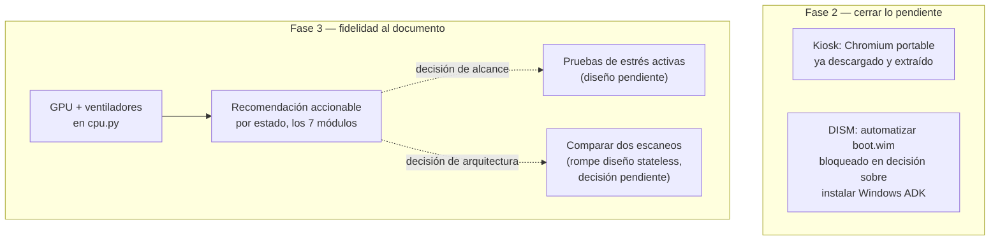

# Fidelidad al documento del Semillero + cierre de Fase 2 — Implementation Plan

> **For agentic workers:** REQUIRED SUB-SKILL: Use superpowers:subagent-driven-development (recommended) or superpowers:executing-plans to implement this plan task-by-task. Steps use checkbox (`- [ ]`) syntax for tracking.

**Goal:** Cerrar lo que quedó pendiente de la Fase 2 del pivote a WinPE (kiosk, DISM) y agregar al software lo que el documento institucional del Semillero promete y hoy no cumple (GPU/ventiladores, recomendaciones accionables), dejando lo que requiere una decisión de alcance mayor (pruebas de estrés, comparación de escaneos) documentado para después.

**Architecture:** Sin cambios de arquitectura. GPU/ventiladores se agregan como campos nuevos en `cpu.py` (ya tiene el precedente de leer temperatura opcional; GPU/fan son telemetría de enfriamiento, mismo dominio). Las recomendaciones se agregan como una llave nueva `recomendacion` en el contrato de los 7 módulos — cambio transversal, toca los 7 archivos + `scanner.py` + el frontend.

**Tech Stack:** LibreHardwareMonitorLib (ya integrado desde `fuente_poder.py`, mismas DLLs en `backend/native/lhm/`), sin dependencias nuevas para GPU/ventiladores ni recomendaciones.

**Spec:** `C:\Users\User\Documents\Diagnostic Scanner\SEMILLERO DE MANTENIMIENTO_DIAGNOSTIC SCANNER PC.docx` (documento institucional — las promesas concretas de la app viven en la sección OBJETIVOS, Fase II).

## Global Constraints

- El contrato de módulo actual (`componente`, `estado`, `mensaje`, `datos`) se **extiende**, no se reemplaza — agregar `recomendacion` no puede romper lo que ya funciona.
- Los 7 componentes de `scanner.py COMPONENTES` no cambian de cantidad — GPU/ventiladores son campos nuevos dentro de módulos existentes, no un 8vo componente.
- Sin datos inventados: todo campo nuevo se verifica en hardware real antes de darse por terminado (mismo criterio que ya se usó para WMI/LibreHardwareMonitorLib en toda la sesión).
- Sin suite de tests automatizados en este proyecto — la verificación de cada tarea es correr el módulo/servidor real y confirmar la salida, igual que el resto del plan de pivote a WinPE.

---

## Diagrama: qué se cierra y qué se agrega



---

## Task 1: Terminar el kiosk (cierre de Fase 2)

**Files:**
- Verify: `build/chromium-extracted/chrome-win/chrome.exe` (ya descargado y extraído esta sesión)
- Modify: `build/overlay-winpe/iniciar.bat` (ya reescrito para modo kiosk, pendiente de probar con el Chromium real)

- [x] **Verificar que el Chromium portable arranca solo, apuntando al servidor real:**

```
cd backend
python app.py
```

En otra terminal:
```
"..\build\chromium-extracted\chrome-win\chrome.exe" --kiosk --noerrdialogs --disable-infobars --disable-session-crashed-bubble --disable-translate --disable-pinch --overscroll-history-navigation=0 --no-first-run --fast --fast-start "http://localhost:5000"
```

Confirmar: abre en pantalla completa, sin barra de direcciones, mostrando el dashboard real.

- [x] **Copiar `chromium-extracted/chrome-win/` a `D:\chromium\` en el USB** (mismo nombre de carpeta que espera `iniciar.bat`: `set CHROME=%USB%chromium\chrome.exe`)

- [x] **Marcar Task #3 del tracker como completa** una vez verificado.

---

## Task 2: Decisión sobre DISM/Windows ADK (Fase 2, bloqueada)

No es una tarea de código — es una decisión pendiente del usuario: instalar el componente "Deployment Tools" del Windows ADK (~100-200MB) para tener `oscdimg.exe` y poder reempacar el ISO final. Hasta que se decida, `create_pe.ps1` no se puede completar ni probar de punta a punta. Retomar cuando el usuario confirme.

---

## Task 3: GPU y ventiladores en `cpu.py`

**Files:**
- Modify: `backend/modules/cpu.py` (reemplaza completo)
- Modify: `frontend/static/js/app.js` (agrega etiquetas para los campos nuevos)

**Interfaces:**
- Produce: mismo contrato de siempre, `datos` gana dos llaves nuevas: `temperatura_gpu_c` (float o `None`) y `ventiladores` (lista de `{nombre, rpm}`, puede ser vacía).

- [x] **Reemplazar `backend/modules/cpu.py`:**

```python
"""
backend/modules/cpu.py — Diagnóstico del procesador (WMI + LibreHardwareMonitorLib, Windows/WinPE).

Win32_Processor para identidad y conteo de núcleos/hilos (sin cambios).
Temperatura de CPU vía MSAcpi_ThermalZoneTemperature (WMI) — sigue como
antes, con el mismo límite ya documentado (no todos los laptops la
exponen).

Temperatura de GPU y velocidad de ventiladores se agregan vía
LibreHardwareMonitorLib (mismas DLLs que fuente_poder.py, en
backend/native/lhm/) — cumple la promesa de "umbrales térmicos de CPU y
GPU" y "telemetría de ventiladores" del documento institucional del
Semillero (Fase II de objetivos específicos), que hasta ahora la app no
cumplía. Ambos campos son opcionales: no todo laptop tiene GPU dedicada
detectable ni ventiladores con sensor de RPM expuesto — su ausencia se
refleja como None/lista vacía, no como error del componente completo
(mismo criterio de degradación elegante del resto del proyecto).
"""

import os
import sys

import wmi

_LIB_DIR = os.path.join(os.path.dirname(os.path.abspath(__file__)), "..", "native", "lhm")
if _LIB_DIR not in sys.path:
    sys.path.append(_LIB_DIR)

UMBRAL_ADVERTENCIA_C = 70
UMBRAL_CRITICO_C = 85

_ARQUITECTURAS = {0: "x86", 1: "MIPS", 2: "Alpha", 3: "PowerPC", 5: "ARM", 6: "ia64", 9: "x64"}


def diagnosticar() -> dict:
    try:
        conexion = wmi.WMI()
        procesadores = conexion.Win32_Processor()
    except wmi.x_wmi as error:
        return _resultado_error(f"No se pudo consultar WMI: {error}")

    if not procesadores:
        return _resultado_error("WMI no devolvió información del procesador.")

    temperatura = _obtener_temperatura_cpu()
    temperatura_gpu, ventiladores = _obtener_gpu_y_ventiladores()
    datos = _armar_datos(procesadores[0], temperatura, temperatura_gpu, ventiladores)
    estado, mensaje = _clasificar(datos["nombre"], temperatura)
    return {"componente": "cpu", "estado": estado, "mensaje": mensaje, "datos": datos}


def _obtener_temperatura_cpu():
    try:
        raiz_wmi = wmi.WMI(namespace="root/wmi")
        zonas = raiz_wmi.MSAcpi_ThermalZoneTemperature()
        temperaturas = [(z.CurrentTemperature / 10.0) - 273.15 for z in zonas]
        return max(temperaturas) if temperaturas else None
    except wmi.x_wmi:
        return None


def _obtener_gpu_y_ventiladores() -> tuple:
    """LibreHardwareMonitorLib: temperatura de GPU (si hay GPU detectable) y
    velocidad de ventiladores (si el hardware expone sensores de RPM).
    Ninguno de los dos es garantía en todo laptop — se degrada a
    None/lista vacía sin tumbar el resto del diagnóstico de CPU."""
    try:
        import clr

        clr.AddReference("LibreHardwareMonitorLib")
        from LibreHardwareMonitor.Hardware import Computer, SensorType
    except Exception:
        return None, []

    try:
        computer = Computer()
        computer.IsGpuEnabled = True
        computer.IsMotherboardEnabled = True
        computer.Open()
        try:
            temperatura_gpu = None
            ventiladores = []
            for hardware in computer.Hardware:
                hardware.Update()
                es_gpu = "Gpu" in str(hardware.HardwareType)
                for sensor in hardware.Sensors:
                    if sensor.Value is None:
                        continue
                    if es_gpu and sensor.SensorType == SensorType.Temperature and temperatura_gpu is None:
                        temperatura_gpu = round(float(sensor.Value), 1)
                    if sensor.SensorType == SensorType.Fan:
                        ventiladores.append({"nombre": str(sensor.Name), "rpm": round(float(sensor.Value))})
                for sub in hardware.SubHardware:
                    sub.Update()
                    for sensor in sub.Sensors:
                        if sensor.Value is not None and sensor.SensorType == SensorType.Fan:
                            ventiladores.append({"nombre": str(sensor.Name), "rpm": round(float(sensor.Value))})
            return temperatura_gpu, ventiladores
        finally:
            computer.Close()
    except Exception:
        return None, []


def _armar_datos(procesador, temperatura, temperatura_gpu, ventiladores) -> dict:
    return {
        "nombre": " ".join((procesador.Name or "Desconocido").split()),
        "arquitectura": _ARQUITECTURAS.get(procesador.Architecture, "Desconocida"),
        "nucleos_fisicos": procesador.NumberOfCores,
        "hilos_logicos": procesador.NumberOfLogicalProcessors,
        "frecuencia_maxima_mhz": procesador.MaxClockSpeed,
        "temperatura_c": round(temperatura, 1) if temperatura is not None else None,
        "temperatura_gpu_c": temperatura_gpu,
        "ventiladores": ventiladores,
    }


def _clasificar(nombre: str, temperatura) -> tuple:
    if temperatura is None:
        return "ok", f"{nombre}: detectado, sin datos de temperatura disponibles."
    if temperatura > UMBRAL_CRITICO_C:
        return "critico", f"{nombre}: temperatura crítica ({temperatura:.1f}°C)."
    if temperatura >= UMBRAL_ADVERTENCIA_C:
        return "advertencia", f"{nombre}: temperatura elevada ({temperatura:.1f}°C)."
    return "ok", f"{nombre}: temperatura normal ({temperatura:.1f}°C)."


def _resultado_error(mensaje: str) -> dict:
    return {"componente": "cpu", "estado": "error", "mensaje": mensaje, "datos": None}
```

- [x] **Verificar en la PC de desarrollo:**

```
cd backend
python -c "import sys; sys.path.insert(0,'.'); from modules import cpu; import json; print(json.dumps(cpu.diagnosticar(), indent=2, ensure_ascii=False))"
```

Confirmar que `temperatura_gpu_c` y `ventiladores` aparecen en `datos` (aunque sea `null`/`[]` si el hardware no los expone — eso también es un resultado válido a confirmar, no un fallo).

- [x] **Agregar etiquetas nuevas en `frontend/static/js/app.js`**, en `ETIQUETAS_CAMPOS`:

```javascript
temperatura_gpu_c: "Temperatura GPU", ventiladores: "Ventiladores", rpm: "Velocidad",
```

(van junto a `temperatura_c: "Temperatura"` ya existente)

- [x] **Probar el servidor real completo** (`python app.py`, `curl /api/scan`, revisar que `cpu.datos.ventiladores` no rompa el panel de detalle del frontend — el formateador ya es genérico, debería desglosar la lista sin cambios adicionales).

---

## Task 4: Recomendación accionable por estado (los 7 módulos)

Cambio transversal: agrega una llave `recomendacion` (string) al contrato de cada módulo — vacía en `ok`, con texto concreto en `advertencia`/`critico`/`error`. Es el cambio que más directamente cumple lo que el documento promete ("qué acción correctiva debe ejecutarse").

**Files:**
- Modify: los 7 módulos en `backend/modules/*.py` (agregar `recomendacion` al dict de retorno)
- Modify: `backend/scanner.py` (`_cumple_contrato` — agregar `recomendacion` a `llaves_requeridas`)
- Modify: `frontend/static/js/app.js` (mostrar `recomendacion` en el panel de detalle, destacada)
- Modify: `frontend/static/css/style.css` (estilo para la recomendación — debe leerse distinto al resto del detalle técnico, es la respuesta a "¿y ahora qué hago?")

**Interfaces:**
- Produce: cada módulo devuelve `{"componente", "estado", "mensaje", "datos", "recomendacion"}` — un campo más sobre el contrato ya establecido.

- [x] **Definir el texto de recomendación por módulo y por estado** (tabla de referencia, no código — se usa igual en los 7 módulos):

| Módulo | `advertencia` | `critico` | `error` |
|---|---|---|---|
| `mainboard` | "Verificar visualmente la placa — datos de fábrica sin configurar pueden indicar una placa reacondicionada." | — (mainboard no clasifica crítico hoy) | "No se pudo leer la placa base — revisar conexión de WMI." |
| `cpu` | "Verificar el sistema de enfriamiento — pasta térmica o ventilador podrían necesitar mantenimiento." | "Detener el uso del equipo y revisar refrigeración antes de continuar — riesgo de daño térmico." | "No se pudo leer el procesador — revisar conexión de WMI." |
| `ram` | "Cerrar procesos innecesarios o considerar ampliar RAM si el uso alto es constante." | "Uso de RAM crítico — el equipo puede volverse inestable, revisar procesos o memoria física instalada." | "No se pudo leer la memoria — revisar conexión de WMI." |
| `almacenamiento` | "Programar respaldo de datos como precaución — salud del disco sin confirmar." | "Reemplazar la unidad antes de seguir en uso — riesgo real de pérdida de datos." | "No se pudo leer el disco — revisar conexión física o de WMI." |
| `bateria` | "Monitorear la batería — podría necesitar reemplazo en los próximos meses." | "Reemplazar la batería antes de reasignar el equipo." | "No se pudo leer la batería — revisar conexión de WMI." |
| `red` | "Revisar cables/antena — hay enlace pero con errores de paquetes." | "Revisar la tarjeta de red o su driver — no hay enlace en ninguna interfaz física." | "No se detectó ninguna interfaz de red — revisar hardware o driver." |
| `fuente_poder` | "Voltaje fuera de rango físico esperado — revisar la fuente de poder o el regulador interno." | — | "Diagnóstico de voltajes no disponible en este modo (ver Fase 2 del pivote a WinPE)." |

- [x] **Aplicar en cada módulo**: agregar un diccionario `_RECOMENDACIONES = {"ok": "", "advertencia": "...", "critico": "...", "error": "..."}` al final de cada archivo, y sumar `"recomendacion": _RECOMENDACIONES[estado]` al dict que arma `diagnosticar()`. Mismo patrón en los 7 — no hace falta repetir el código completo de cada módulo acá, es una línea + un diccionario constante por archivo, siguiendo la tabla de arriba.

- [x] **`scanner.py`**, en `_cumple_contrato`:

```python
llaves_requeridas = {"componente", "estado", "mensaje", "datos", "recomendacion"}
```

- [x] **`app.js`**, en `renderizarDetalle`, agregar antes del cuerpo de datos:

```javascript
const recomendacion = info.recomendacion
    ? `<div class="detalle-recomendacion"><strong>Recomendación:</strong> ${info.recomendacion}</div>`
    : "";
```

Y sumar `recomendacion` al template del panel, entre `detalle-mensaje` y `cuerpo`.

- [x] **`style.css`**, agregar `.detalle-recomendacion` con `background-color: var(--color-tarjeta)`, `border-left: 3px solid var(--color-acento)`, padding, para que se destaque del resto del detalle técnico.

- [x] **Probar el servidor real completo** y confirmar que un componente en `critico`/`advertencia` muestra su recomendación en el panel de detalle.

---

## Fase 3B — Roadmap, sin detalle de tarea todavía (requieren decisión antes de planificar en código)

### Pruebas de estrés activas

El documento (Fase IV) promete "pruebas de estrés post-intervención" comparando indicadores antes/después. Hoy los 7 módulos son lecturas pasivas — nunca se implementó una carga activa de CPU/RAM, ni en la versión Linux ni en esta. Antes de planificar esto en código hace falta decidir: duración del estrés (¿10s? ¿30s?), qué se mide durante la carga (temperatura pico, throttling, estabilidad), y el riesgo de someter hardware ya deteriorado a carga activa en un entorno escolar sin supervisión constante. **No arrancar sin esa conversación.**

### Comparar dos escaneos (antes/después)

El documento (Fase IV) también pide comparar salud antes/después de una intervención. La app es *stateless* por diseño (decisión ya documentada en `docs/DECISIONES.md`) — agregar esto implica romper esa decisión (aunque sea parcialmente, guardando el escaneo anterior además del último). **Decisión de arquitectura pendiente de confirmar** antes de tocar código: ¿guardar 2 escaneos en memoria alcanza, o hace falta persistir a disco (rompe "stateless" más en serio)?

---

## Self-Review

**Cobertura:** Task 1-2 cierran Fase 2 (kiosk, DISM). Task 3-4 cubren las dos brechas del documento que sí se pueden cerrar con el alcance actual (GPU/ventiladores, recomendaciones). Las dos brechas restantes (estrés, comparación) quedan explícitamente fuera de esta ronda, con la razón documentada — no se omiten en silencio.

**Sin placeholders:** Task 3 tiene el módulo `cpu.py` completo y real. Task 4 tiene la tabla de recomendaciones completa (7 módulos x 4 estados) y el patrón exacto de código a aplicar — no repetí los 7 archivos completos porque el cambio es mecánico y ya se explicita la línea + diccionario exacto por archivo.

**Consistencia de contrato:** `recomendacion` se agrega en Task 4 a los 7 módulos + `scanner.py` + frontend en el mismo task — ningún módulo queda con el contrato viejo mientras otro ya tiene el nuevo.
